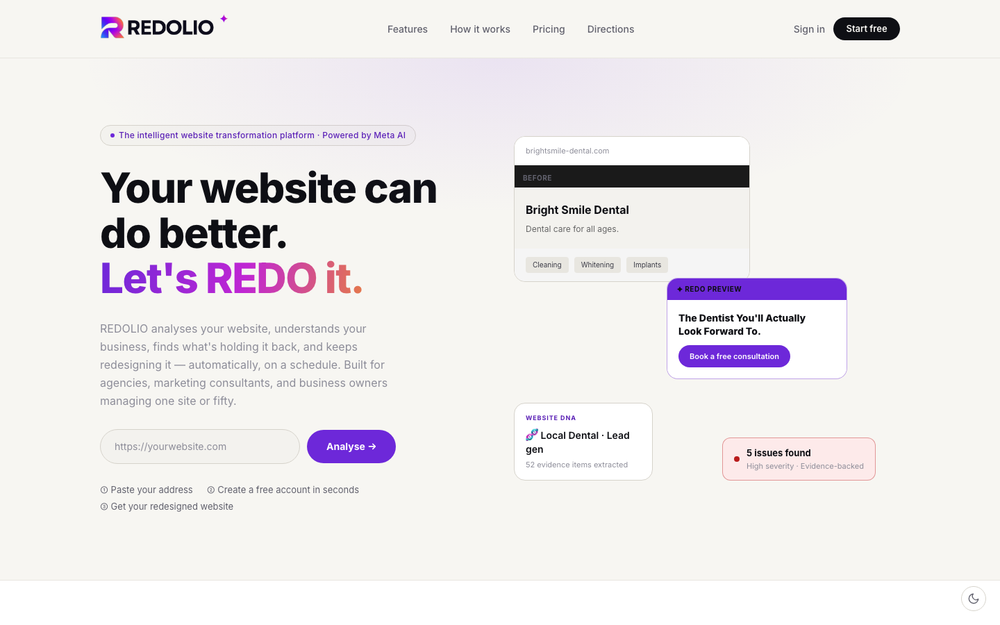
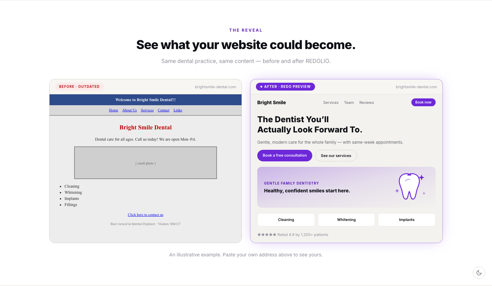
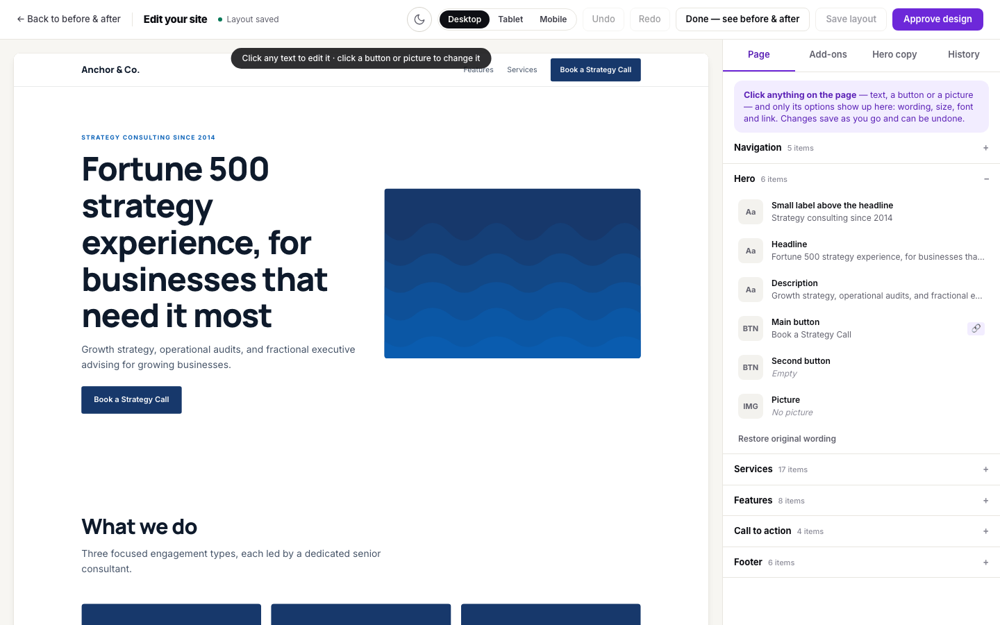

<p align="center">
  <picture>
    <source media="(prefers-color-scheme: dark)" srcset="public/brand/redolio-logo-darkbg.png">
    
  </picture>
</p>

<p align="center"><strong>Let's REDO it.</strong> The intelligent website transformation platform, powered by the Meta Model API.</p>

<p align="center">
  <a href="https://github.com/terrytsang/redolio/actions/workflows/tests.yml"></a>
  <a href="LICENSE"></a>
  
  
</p>

<p align="center"></p>

REDOLIO reads a website, works out what the business does and what is holding the site back, and builds a
brand-new version you can compare side by side — then lets you edit it on the page and download or publish it.

- **Website DNA** — an AI reading of the business: what it does, who it serves, what makes it different.
- **Evidence-backed diagnosis** — every issue is linked to something actually found on the site.
- **A redesigned website** — pick a design direction and layout, preview it next to the original, edit text, pictures,
  layout and add-ons right on the page (drag-and-drop add-ons, Unsplash and AI image search), then download clean
  HTML/CSS/JS or publish it.
- **Watch reports** — scheduled re-scans that tell you how a site changed.
- **Admin portal** — dashboard, users, visitor analytics, design directions (import a `DESIGN.md` style or capture one from a website).

Built with **Laravel 13 · PHP 8.4 · Tailwind CSS v4**, using the **Meta Model API** (Muse) by default. Claude, ChatGPT and
Gemini can be switched on in the admin settings.

## See it work

**Before and after, side by side** — the original site next to its REDOLIO redesign:

<p align="center"></p>

**Edit the new design right on the page** — click any text, button or picture; drag add-ons up and down; pick layouts, fonts and images:

<p align="center"></p>

## Get started

You need PHP 8.4+, Composer, Node 20+ and **MySQL 8** (MariaDB 10.6+ also works). MySQL is the default database; SQLite works too if you just want to try it (see below).

```bash
git clone https://github.com/terrytsang/redolio.git
cd redolio

composer install
npm install && npm run build

cp .env.example .env            # your own settings — this file is git-ignored, never commit it
php artisan key:generate

# create an empty MySQL database, then put its name and login in .env (DB_DATABASE, DB_USERNAME, DB_PASSWORD)
mysql -u root -p -e "CREATE DATABASE redolio CHARACTER SET utf8mb4 COLLATE utf8mb4_unicode_ci;"

php artisan migrate --seed      # creates the tables, design catalogue, plans AND your first admin
```

> **Just trying it out with SQLite instead?** In `.env` set `DB_CONNECTION=sqlite` (and remove the other `DB_*` lines), run
> `touch database/database.sqlite`, then `php artisan migrate --seed`.

The seeder prints your first admin login **once** (a random password — save it). Prefer your own? Put
`ADMIN_EMAIL` and `ADMIN_PASSWORD` in `.env` before running it.

```bash
php artisan serve               # http://localhost:8000
php artisan queue:work          # keep this running: analyses and designs are built by background jobs
```

### Add your Meta Model API key

REDOLIO ships with **no API key** — you bring your own, so nothing secret is ever in the source code.

1. Sign in at `/login` with the admin account the seeder created, then open **Admin → Settings**.
2. The **Active provider** is already **Meta Model API**. In the **Meta Model API** section, **API base URL**
   (`https://api.meta.ai/v1`) and **Model ID** (`muse-spark-1.3`) are pre-filled.
3. Paste your **API key** and press **Save settings**. (Or set `META_API_KEY` in `.env`.)

Until a key is added the app runs in demo mode. Keys saved in Settings are stored encrypted with your `APP_KEY`.

### Screenshots and visual checks

Screenshots and visual checks need a browser. Locally: `npx playwright install chromium` and keep
`REDO_BROWSER_PROVIDER=local`. On shared hosting that cannot run Chromium, use a cloud browser: set
`REDO_BROWSER_PROVIDER=browserbase` (and `BROWSERBASE_API_KEY`) or `browserless` (`BROWSERLESS_API_KEY`), and
`npm install` so `playwright-core` is present. `REDO_BROWSER_FALLBACK` names a backup provider used automatically if the first fails.

### Editions

| `REDO_EDITION` | What it is |
|---|---|
| `selfhosted` (default in `.env.example`) | Your own installation: no plans or billing, no usage limits, you are the admin. |
| `saas` | A hosted multi-user service with Free / Starter / Agency plans, one-time Export Pass, Stripe billing, quotas and an admin portal with MRR. Set the `STRIPE_*` values in `.env` (webhook: `{APP_URL}/stripe/webhook`). |

### Optional

- **Scheduler** (watch rescans, cleanup): add a cron entry `* * * * * cd /path/to/redolio && php artisan schedule:run >> /dev/null 2>&1`.
- **Mail**: the default writes emails to the log; set `MAIL_*` for real delivery.
- **Integrations** (each hides itself until its key is set): `UNSPLASH_ACCESS_KEY`, `PEXELS_API_KEY`, `GOOGLE_CLIENT_ID` ("Continue with Google").
- **Page-layout previews**: layout readiness is read from `storage/app/public/blueprint-previews`, generated by `php artisan blueprints:capture`
  (see `docs/v1.5-runbook.md`). Run it once after installing if you add directions.

## Tests

```bash
php artisan test
```

## Security

Never commit `.env` or real keys (`.env` is git-ignored). To report a security issue, please open a private security
advisory on GitHub instead of a public issue.

## License

MIT — see [LICENSE](LICENSE).
